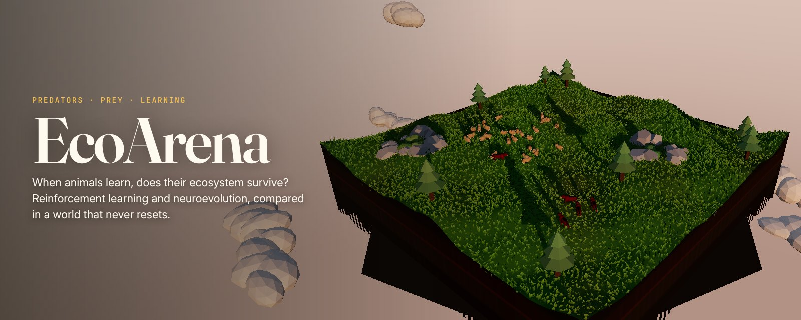
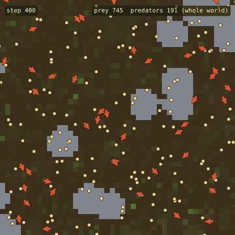
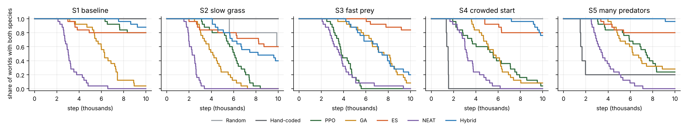
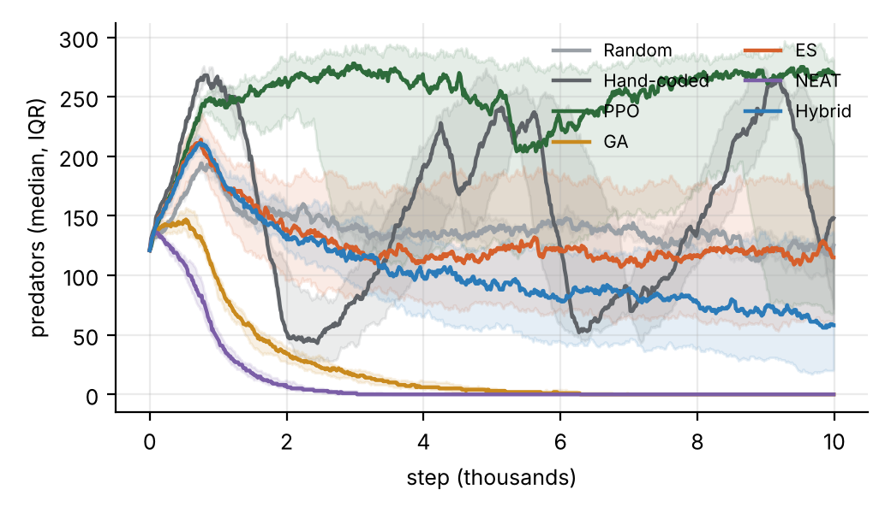
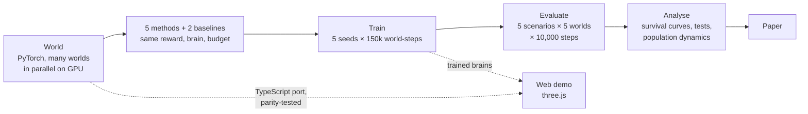
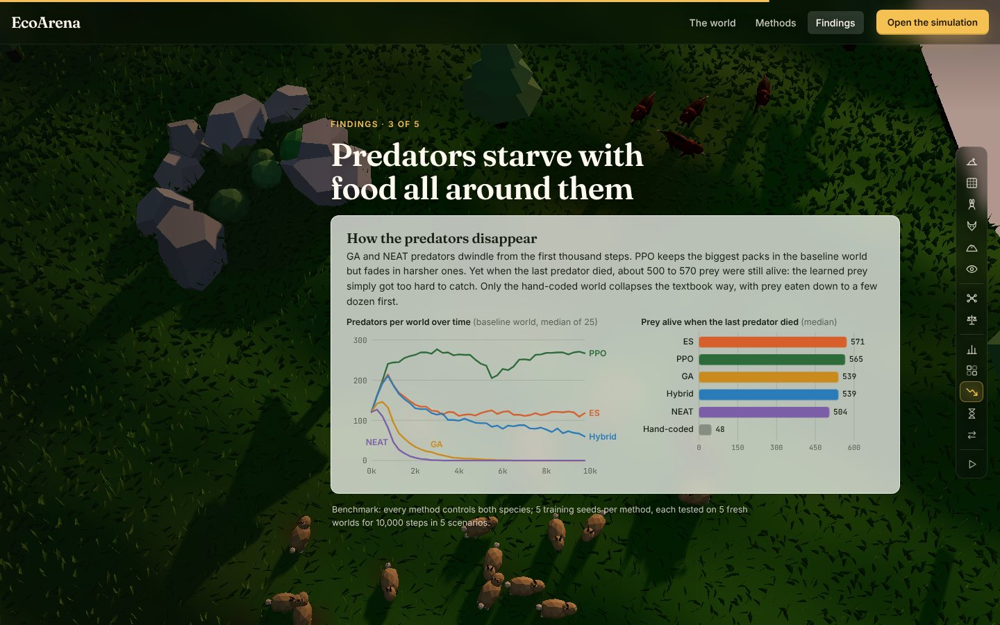
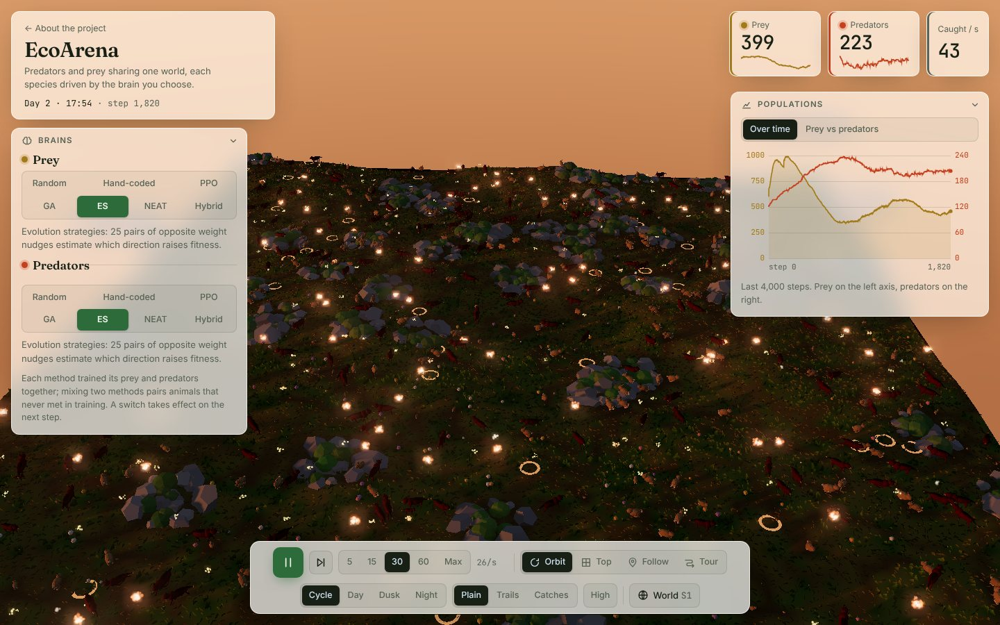

<p align="center">
  <a href="http://eco.mirazulislamnahid.com/"></a>
</p>

<p align="center">
  <a href="http://eco.mirazulislamnahid.com/"></a>
  <a href="docs/handbook/EcoArena-Handbook.pdf"></a>
  
  
  
  <a href="LICENSE"></a>
</p>

<p align="center">
  <b>When animals learn, does their ecosystem survive?</b><br>
  A predator–prey world that never resets, where reinforcement learning and neuroevolution<br>
  train both species under the same reward, brain and budget.
</p>

<p align="center">
  <a href="http://eco.mirazulislamnahid.com/"><b>Open the live demo</b></a> ·
  <a href="#the-finding">The finding</a> ·
  <a href="#how-it-works">How it works</a> ·
  <a href="#quick-start">Quick start</a> ·
  <a href="docs/handbook/EcoArena-Handbook.pdf">Team handbook</a>
</p>

---

<table>
<tr>
<td width="46%" valign="top">
  
  <p align="center"><sub>The real benchmark world (Python simulator), trained ES brains. Prey are sand dots, predators red arrows, refuges grey.</sub></p>
</td>
<td width="54%" valign="top">

**EcoArena** is a 2D ecosystem where grass grows, prey eat grass, predators eat prey, and every animal is born, ages and dies inside one continuous run. There are no episodes and no resets.

We hand each species a brain trained by one of five methods and ask two questions:

- **Agent level.** Are the prey good at not being eaten, and the predators good at eating?
- **Ecosystem level.** When a method controls *both* species, do both survive?

| | Method | Family |
|---|---|---|
| M1 | **PPO** | reinforcement learning |
| M2 | **GA** (deep GA) | neuroevolution |
| M3 | **ES** (OpenAI-ES) | neuroevolution |
| M4 | **NEAT** | evolving topologies |
| M5 | **Hybrid** (GA → PPO) | both |
| B0, B1 | Random, Hand-coded | baselines |

</td>
</tr>
</table>

## The finding

> **Learning breaks the ecosystem, and the predators starve with food all around them.**

All 5 methods were each trained with 5 seeds. Every run was then tested on 5 fresh worlds for 10,000 steps in 5 scenarios, giving 875 test worlds in total.

| Worlds with both species alive | S1 baseline | S2 slow grass | S3 fast prey | S4 crowded | S5 many predators | **All** |
|---|---:|---:|---:|---:|---:|---:|
| Random | 100% | 60% | 100% | 100% | 100% | **92%** |
| **ES** | 80% | 60% | 84% | 80% | 80% | **77%** |
| Hybrid | 88% | 40% | 20% | 76% | 96% | **64%** |
| Hand-coded | 100% | 100% | 100% | 0% | 20% | **64%** |
| PPO | 80% | 0% | 0% | 4% | 24% | **22%** |
| GA | 4% | 0% | 8% | 8% | 28% | **10%** |
| NEAT | 0% | 0% | 0% | 0% | 0% | **0%** |

- **Every collapse is the predators dying out.** Prey never went extinct in any of the 875 worlds.
- **Not from over-hunting.** When the last predator died, a median of **500–570 prey were still alive** in every learned method (worlds start with about 660). Only the hand-coded predators over-hunted: their prey fell to about 8 first.
- **The prey win the arms race.** GA and NEAT predators catch as many prey per step as random ones, yet live the shortest lives and dwindle from the start. PPO keeps the biggest predator packs in the baseline world, but they fade in harsher ones.
- **Training hid it.** When a species died out during training, the world was reset, so no learner ever paid for wrecking its ecosystem. PPO's training worlds collapsed 9–15 times per run, NEAT's 7–12 times.

<p align="center">
  
  <br><sub>Share of test worlds still holding both species over time (Kaplan–Meier). Log-rank p &lt; 0.001 for most comparisons against PPO in S2–S5.</sub>
</p>

<p align="center">
  
  <br><sub>Predators per world in the baseline world (median of 25, shaded: middle half). GA and NEAT fade from the start; the hand-coded world cycles.</sub>
</p>

Full statistics (bootstrap CIs, permutation and log-rank tests) are in [`results/bench/STATS.md`](results/bench/STATS.md), with a summary in [`SUMMARY.md`](results/bench/SUMMARY.md) and the dynamics in [`DYNAMICS_S1.md`](results/bench/DYNAMICS_S1.md). A follow-up study, now running, tests *why*: training horizon, group versus individual selection, and the arms race between learning speeds ([`scripts/study.py`](scripts/study.py)).

## How it works



**The world.**
- A 200 × 200 map with wrap-around edges.
- Grass on a 100 × 100 grid that regrows logistically.
- 48 refuges, where prey can't be caught but grass stays short.
- About 600 prey and 120 predators at the start.

**Energy.** Moving and living cost energy, and eating gives it back. Breeding hands energy to the child. Predators catch only half their lunges, digest for 60 steps after a catch, and are stunned for 40 after a miss.

**What animals see and do.**
- **Senses:** 16 vision sectors, 240° for prey and 120° for predators.
- **Observation:** 102 numbers.
- **Actions:** 2 numbers, turn and thrust.

**A fair comparison.**
- **Same reward:** energy gained minus energy spent, and −1 for dying.
- **Same brain:** a 102 → 64 → 64 → 2 network (NEAT grows its own).
- **Same budget:** 150,000 world-steps per run.
- **Same tests.**

Animals live in fixed tensor slots, so births and deaths never stop the GPU. Randomness is a counter-based hash, so the browser reproduces the Python world step for step.

<table>
<tr>
<td width="50%"><p align="center"><sub>The landing page tells the story in 14 scroll chapters.</sub></p></td>
<td width="50%"><p align="center"><sub>The live simulation: pick a brain per species, change scenario, follow an animal.</sub></p></td>
</tr>
</table>

## Quick start

```bash
uv venv --python 3.12 && source .venv/bin/activate
uv pip install torch                 # CUDA build; RTX 50xx cards need CUDA 12.8+
uv pip install -e ".[dev]"
pytest -q                            # 85 tests, CPU, under a minute

# watch a healthy world with the hand-coded animals
python scripts/run_baseline.py --policy heuristic --worlds 5 --steps 10000 --base s1_large.json

# train one method on both species (also train_ga.py, train_es.py, train_neat.py, train_hybrid.py)
python scripts/train_ppo.py --learn prey predator --name my-ppo
```

For a first try on a laptop, add `--base s1_balanced.json --world-steps 20000 --device cpu`.

### Reproduce the benchmark

```bash
python scripts/benchmark.py train     # 25 runs: 5 methods × 5 seeds   (~6.5 h on an RTX 5060 Ti)
python scripts/benchmark.py eval      # 5 scenarios × 5 worlds × 10k steps   (~2 h)
python scripts/benchmark.py table     # TABLES.md and per_world.csv
python scripts/analyze.py             # figures and STATS.md
python scripts/dynamics.py            # cycles, Lotka–Volterra fits, phase portraits
```

Every command is resumable: stop it at any time, run it again, and finished runs are skipped.

### Run the web demo

```bash
cd web && pnpm install
pnpm dev                              # http://localhost:5173
pnpm test                             # Python ↔ TypeScript parity test
pnpm build                            # static site + dist/ecoarena.html (one file)
docker build -f web/Dockerfile -t ecoarena-web .   # Nginx image (run from the repo root)
```

## Repository

```
configs/      world rules as JSON, shared by Python and the browser
ecoarena/     env/ (the world), policies/ (baselines), trainers/ (PPO, GA, ES, NEAT), eval/
scripts/      train_*, benchmark, study, analyze, dynamics, export_web
results/      checkpoints, histories, evaluations, figures; results/bench = the benchmark
web/          Vite + React + three.js demo, landing page and live simulation
docs/         team handbook (PDF) and README assets
tests/        pytest suite
```

New to the project? Start with the [team handbook](docs/handbook/EcoArena-Handbook.pdf). It covers the theory, every rule, each method, the results and all the commands in 29 pages.

## Citation

```bibtex
@misc{ecoarena2026,
  title        = {EcoArena: Learned Predators and Prey in a World That Never Resets},
  author       = {Islam, Mirazul and Alam, Fairoze Fatema and Prova, Mehejabin and Sajid, Afnan Zaman Mohammad and Shishir, Julkar Naim},
  year         = {2026},
  howpublished = {\url{https://github.com/TheRealNightmare/EcoArena}},
  note         = {Machine Learning course project, United International University}
}
```

## License

[MIT](LICENSE). The fonts in the web demo (Fraunces, Inter, JetBrains Mono) are under the SIL Open Font License.
